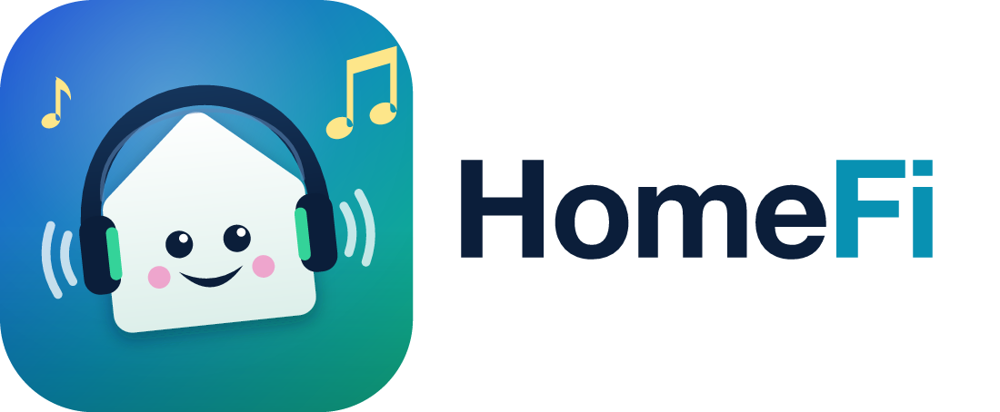

<p align="center">
  
</p>

<p align="center">
  A hi-fi music player for your own files and your TIDAL subscription, on desktop
  (macOS, Windows, Linux), Android and the terminal: bit-perfect playback, synced lyrics,
  listening-room layouts, shared control between devices, and offline copies in max quality.
</p>

> [!IMPORTANT]
> **Personal, non-commercial use only.** HomeFi is an independent project, not affiliated with or
> endorsed by TIDAL. It requires your own paid TIDAL subscription. It is for personal,
> non-commercial use only: listening to and keeping copies, for yourself and on your own devices,
> of music your subscription gives you access to. Do not share, sell, upload or distribute the
> files, and do not use them in public or commercial settings. You are responsible for complying
> with TIDAL's terms and your country's copyright laws. If you cancel your subscription, delete
> what you downloaded. The apps ask you to accept this before connecting a TIDAL account.

## Download

The latest version, straight from the [releases page](https://github.com/joseespana/homefi/releases/latest):

| Platform | Download |
| --- | --- |
| macOS (Apple Silicon) | [HomeFi-macos-arm64.dmg](https://github.com/joseespana/homefi/releases/latest/download/HomeFi-macos-arm64.dmg) |
| macOS (Intel) | [HomeFi-macos-x64.dmg](https://github.com/joseespana/homefi/releases/latest/download/HomeFi-macos-x64.dmg) |
| Windows 10/11 (x64) | [Installer (.exe)](https://github.com/joseespana/homefi/releases/latest/download/HomeFi-windows-x64.setup.exe) · [MSI](https://github.com/joseespana/homefi/releases/latest/download/HomeFi-windows-x64.msi) |
| Windows 11 (ARM) | [Installer (.exe)](https://github.com/joseespana/homefi/releases/latest/download/HomeFi-windows-arm64.setup.exe) |
| Linux (x86_64) | [.deb](https://github.com/joseespana/homefi/releases/latest/download/HomeFi-linux-x86_64.deb) · [.rpm](https://github.com/joseespana/homefi/releases/latest/download/HomeFi-linux-x86_64.rpm) · [AppImage](https://github.com/joseespana/homefi/releases/latest/download/HomeFi-linux-x86_64.AppImage) |
| Linux (arm64) | [.deb](https://github.com/joseespana/homefi/releases/latest/download/HomeFi-linux-arm64.deb) · [.rpm](https://github.com/joseespana/homefi/releases/latest/download/HomeFi-linux-arm64.rpm) · [AppImage](https://github.com/joseespana/homefi/releases/latest/download/HomeFi-linux-arm64.AppImage) |
| Android 8+ | [HomeFi-android.apk](https://github.com/joseespana/homefi/releases/latest/download/HomeFi-android.apk) |
| CLI | [all platforms](https://github.com/joseespana/homefi/releases/latest) (`homefi-cli-<target>.tar.gz` / `.zip`) |

Checksums: [SHA256SUMS](https://github.com/joseespana/homefi/releases/latest/download/SHA256SUMS).

- **macOS**: the app isn't notarized by Apple. The first time, open it, then go to
  System Settings → Privacy & Security → **Open Anyway**.
- **Windows**: SmartScreen may say "Windows protected your PC": **More info → Run anyway**.
- **Android**: allow installing apps from your browser or file manager when asked.

HomeFi is a Rust + Kotlin rewrite of [tiddl](https://github.com/oskvr37/tiddl). It keeps
tiddl's config file, path templates and CLI flags, so existing setups keep working.

## Repository layout

```
homefi/
├── Cargo.toml                 # Rust workspace, the version of everything lives here
├── crates/
│   ├── homefi-core/           # Tidal auth + API, streams, lyrics, library, tagging, downloads, shared control
│   ├── homefi-player/         # bit-perfect audio engine of the desktop app
│   ├── homefi-cli/            # `homefi` command line app
│   └── homefi-ffi/            # UniFFI bindings of the core for Android and iPhone
├── apps/
│   ├── desktop/               # Tauri 2 + Svelte 5 app for macOS, Windows and Linux
│   ├── android/               # Kotlin + Jetpack Compose app
│   └── ios/                   # SwiftUI app (in progress, built from Xcode)
├── xtask/                     # `cargo xtask icons | bump | version`
├── assets/brand/              # logo sources (SVG) and rendered PNG / ICO
├── docs/                      # config example, templating, shared control, releasing
└── .github/workflows/         # CI + release pipeline
```

The download engine lives in `homefi-core` and reports progress as events. The CLI draws
them with progress bars, and the Android app shows them in Compose and in a notification.

## CLI

### Install

Grab an archive for your platform from the
[releases page](https://github.com/joseespana/homefi/releases/latest), or build it:

```bash
cargo install --path crates/homefi-cli --locked   # or: make install
```

[`ffmpeg`](https://ffmpeg.org/download.html) is optional but recommended. HomeFi uses it to unwrap
Hi-Res FLAC from its MP4 container, remux videos and convert to MP3/FLAC (`--format`).
Install it with `brew install ffmpeg`, `winget install ffmpeg` or `sudo apt install ffmpeg`.

### Usage

```bash
homefi auth login                          # device login in your browser
homefi download url https://tidal.com/browse/album/103805723
homefi dl url track/12345 playlist/<uuid> mix/<id> artist/7
homefi dl -q max -o "{album.artist}/{album.title}/{item.number:02d}. {item.title}" url album/123
homefi dl fav -t album,playlist            # your favorites
homefi dl search "daft punk discovery"     # interactive search
homefi dl search "one more time" -T        # download the top hit
homefi config init                         # write a commented ~/.homefi/config.toml
homefi --help
```

| Option | Description |
| --- | --- |
| `-q, --track-quality` | `low` (96 kbps), `normal` (320 kbps), `high` (FLAC 16-bit), `max` (FLAC up to 24-bit/192 kHz) |
| `--vq, --video-quality` | `sd`, `hd`, `fhd` |
| `-o, --output` | path template, see [docs/templating.md](docs/templating.md) |
| `-p, --path` / `--sp, --scan-path` | download dir / where existing files are looked up |
| `-f, --format` | `original`, `flac`, `mp3` (needs ffmpeg) |
| `-s, --singles` | artist downloads: `none`, `only`, `include` |
| `--vid, --videos` / `--da, --dolby-atmos` | `none`, `allow`, `only` |
| `-t, --threads-count` | concurrent downloads |
| `--ns, --no-skip` / `-r, --rewrite-metadata` | re-download / re-tag existing files |

App data lives in `~/.homefi` (`%USERPROFILE%\.homefi` on Windows). Set `HOMEFI_PATH` to move it.
Every option can be set in `config.toml`: see [docs/config.example.toml](docs/config.example.toml).
Coming from tiddl? Copy `~/.tiddl/config.toml` and `auth.json` into `~/.homefi/`.

If the default client credentials stop working, set `HOMEFI_AUTH=<CLIENT_ID>;<CLIENT_SECRET>`.

## Android app

Features:

- **Player**: library of your downloads plus the music already on the phone (`Music`, `Download`), with
  Songs / Albums / Artists, cover art, format and resolution (`FLAC · 24-bit / 192 kHz`), queue, shuffle,
  repeat, background playback with notification and lock-screen controls, headset buttons, and
  "Open with HomeFi" from any file manager. The player works without a Tidal account.
- **Downloads**: Tidal device login, search with covers, paste or share Tidal links from the Tidal app,
  a download queue with a progress notification, and tags with cover art and lyrics. Files are saved in
  `Music/HomeFi` (after you grant "All files access") or in the app's music folder.

- **Album versions** (also on the desktop): Tidal lists some albums several times (explicit and clean,
  stereo and Dolby Atmos, 16 and 24-bit, remasters, deluxe box sets). Artist pages, search and favorite
  albums show one card per album with an **E** badge when it's explicit and a "3 versions" chip; the chip
  (or a long-press, a right-click on the desktop) lists every release with its labels, and Play / Open /
  Download each. Album pages show their labels and "Other versions". Settings → Tidal account → Album
  versions: one card per album on / off, and which release the card shows (explicit or clean, stereo or
  Dolby Atmos, original or latest remaster; the highest quality wins among the rest).
- **Crossfade** (also on the desktop, off by default so playback stays gapless and bit-perfect):
  Settings → Playback. The next song starts while the current one fades out, 1 to 12 s, with an
  equal-power, S-curve or linear curve. "Skip the silence" fades from where the music really ends into
  where the next song starts; "Keep albums gapless" leaves consecutive songs of one album in order
  untouched; "Fade when I skip" gives next / previous / picking a song a short fade (0.5 to 3 s);
  songs shorter than twice the fade (or a length you pick) never fade. Each song keeps its own
  equalizer, taste layer and loudness during the overlap. The phone plays the two songs on two
  players; with "Turn off on slow phones" (on by default) phones with under 2 GB of memory, or that lag
  twice during fades, change songs as usual instead. The now-playing screen shows "Crossfading into …"
  while it happens.

| Format | Playback |
| --- | --- |
| FLAC (up to 24-bit / 192 kHz, also FLAC inside `.m4a` / `.mka`) | ✅ |
| MP3, WAV (16/24-bit PCM), AAC / M4A, Ogg Vorbis, Opus, AMR | ✅ |
| ALAC (`.m4a`, up to 24-bit / 96 kHz tested), AC-3 | ✅ through the bundled FFmpeg decoder |
| APE, WMA, DSD, WavPack | ❌ not supported |

The library scanner is part of `homefi-core` (`library.rs`, lofty), so formats and audio properties
are read the same way as the downloader writes them. Decoding uses Media3 ExoPlayer with the device's
decoders first and [Jellyfin's Media3 FFmpeg decoder](https://github.com/jellyfin/jellyfin-androidx-media)
for codecs Android lacks (ALAC, AC-3, E-AC-3, DTS, TrueHD).

> [!NOTE]
> The FFmpeg decoder is GPL-3.0, so the **Android APK as distributed is GPL-3.0**. The HomeFi source code and
> the CLI stay Apache-2.0. See [NOTICE](NOTICE).

Install the APK from the [Download](#download) table above. To build it yourself you need JDK 17+, the Android SDK with
NDK `29.0.14206865`, the Rust Android targets and `cargo-ndk`:

```bash
rustup target add aarch64-linux-android armv7-linux-androideabi x86_64-linux-android
cargo install cargo-ndk
sdkmanager "ndk;29.0.14206865"

make android-debug      # debug APK, arm64 only (fast)
make android            # release APK, all ABIs
make android-install    # install the debug build through adb
```

Gradle compiles the Rust library with `cargo-ndk` and generates the Kotlin bindings with
`uniffi-bindgen` before each build, so no manual steps are needed. You can also open
`apps/android` in Android Studio.

Android has no ffmpeg, so Hi-Res (`max`) tracks are kept as FLAC inside `.m4a`. Lossless (`high`)
tracks are plain `.flac`.

## Versions and releases

One version, `[workspace.package].version` in `Cargo.toml`, is used everywhere: CLI `--version`,
the core, and the Android `versionName`/`versionCode` (`major*1e6 + minor*1e3 + patch`).

```bash
cargo xtask bump 0.2.0      # or: make bump V=patch|minor|major
git commit -am "release: v0.2.0"
git tag v0.2.0 && git push --follow-tags
```

The tag triggers `.github/workflows/release.yml`. It builds the CLI for Linux (x86_64/arm64),
macOS (arm64/x86_64) and Windows, plus the signed APK, then publishes a GitHub release with
checksums and the matching `CHANGELOG.md` section. `make dist` builds the same artifacts locally
into `dist/`. Signing setup is described in [docs/releasing.md](docs/releasing.md).

## Development

```bash
make check     # fmt + clippy + tests
make icons     # re-render assets/brand after editing the SVGs
make help
```

## License

Source code: Apache-2.0, see [LICENSE](LICENSE) and [NOTICE](NOTICE). Based on tiddl by oskvr37.
The Android APK bundles GPL-3.0 components (FFmpeg decoder) and is distributed under GPL-3.0.
